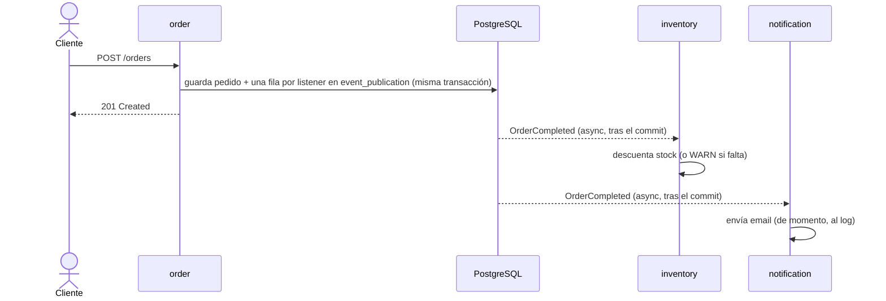

# Spring Modulith Shop

Proyecto de ejemplo de un **monolito modular** con [Spring Modulith](https://spring.io/projects/spring-modulith): una tienda mínima donde cada módulo tiene fronteras claras, se comunica por eventos y puede probarse por separado.

Acompaña a una serie de 4 artículos del [blog de DatIACode](https://www.datiacode.com/blog). Cada artículo apunta a un tag de git con el estado exacto del código que explica (ver [Tags y artículos](#tags-y-artículos)).

> **Qué no es:** un e-commerce completo. No hay frontend, pagos ni catálogo con búsqueda; solo lo justo para que los conceptos de Modulith tengan un escenario creíble.

## Stack

| Pieza | Versión |
|---|---|
| Java | 21 |
| Spring Boot | 4.1.1 |
| Spring Modulith | 2.1.1 |
| Spring AI | 2.0.1 |
| PostgreSQL | 16 (Docker) |
| Redpanda (API de Kafka) + Redpanda Console | 24.2.4 / 2.7.2 (Docker) |
| Mailpit | 1.31.3 (Docker) |
| Ollama + `llama3.2:3b` | 0.34.4 (Docker, perfil `ai`) |
| Spring Security | gestionado por Spring Boot |
| Flyway | gestionado por Spring Boot |
| springdoc-openapi | 3.1.1 |

## Requisitos

- JDK 21
- Docker + Docker Compose
- No hace falta Maven instalado: el proyecto incluye `./mvnw`.

## Arranque rápido

```bash
# 1. Variables locales (credenciales de desarrollo)
cp .env.example .env

# 2. Infraestructura: PostgreSQL (5442), Redpanda (19092), su consola (8091) y Mailpit (1026/8026)
docker compose up -d
#    Opcional, para el módulo de IA: Ollama (11434) solo arranca con el perfil "ai"
docker compose --profile ai up -d

#    Una sola vez: el modelo local (~2 GB)
curl localhost:11434/api/pull -d '{"model":"llama3.2:3b"}'

# 3. Aplicación con el perfil dev
./mvnw spring-boot:run -Dspring-boot.run.profiles=dev

# 4. Comprobación
curl localhost:8080/actuator/health
# {"groups":["liveness","readiness"],"status":"UP"}

# 5. Flujo completo: un pedido como alice (contraseña: DEMO_PASSWORD de .env)
curl -u alice:change-me -X POST localhost:8080/orders -H 'Content-Type: application/json' \
  -d '{"items":[{"sku":"KB-001","quantity":1},{"sku":"MS-001","quantity":2}]}'
```

Flyway crea el esquema al arrancar. Hibernate solo lo valida (`ddl-auto=validate`).

Tras el `201`, en unos segundos:

| Dónde | Qué ves |
|---|---|
| Log de la app | `inventory` descuenta stock y `notification` registra el pedido con el usuario `alice` y el traceId de la petición |
| Mailpit · <http://localhost:8026> | El email de confirmación redactado por el LLM (o el texto de respaldo si Ollama no está levantado) |
| Redpanda Console · <http://localhost:8091> | El evento en el topic `shop.orders.completed` |
| Swagger UI · <http://localhost:8080/swagger-ui/index.html> | La API, para probar sin `curl` (botón *Authorize* con `alice`) |

## Tests

```bash
./mvnw verify                                   # todo (lo que se ejecuta en CI)
./mvnw test -Dtest='*Test'                       # sin Docker: unitarios, @WebMvcTest y ModularityTest
./mvnw test -Dtest='*ModuleTests'                # un módulo aislado con @ApplicationModuleTest + Scenario
./mvnw test -Dtest=ModularityTest                # fronteras: verify() + regla ArchUnit
./mvnw test -Pdocs                               # regenera docs/modules/
```

Convención de nombres: `*Test` no arranca contenedores; `*Tests` arranca un contexto de Spring con PostgreSQL (y Redpanda en `ExternalizationTests`) por Testcontainers.

Ningún test necesita Ollama, OpenRouter ni el `docker compose` de desarrollo: el perfil `test` apunta el LLM y el SMTP a un puerto cerrado y los módulos que los usan los mockean.

Los tests de integración levantan PostgreSQL y Redpanda con Testcontainers, así que Docker tiene que estar en marcha. No necesitan el `docker compose` de desarrollo.

| Test | Qué cubre |
|---|---|
| `ModularityTest` | Fronteras entre módulos (`verify()`), named interfaces, que `order` no dependa de `inventory` y regla ArchUnit: solo `ai.internal` usa Spring AI ([por qué](docs/verify-chatclient.md)) |
| `DefaultCatalogServiceTest`, `DefaultInventoryServiceTest`, `DefaultOrderServiceTest` | Lógica de negocio (JUnit 5 + Mockito) |
| `OrderControllerTest` | Capa HTTP con `@WebMvcTest`: 201/400/401/404/422, cliente tomado del usuario autenticado y cabeceras de seguridad |
| `OrderCompletedListenerTest` | Listener de stock, incluida la falta de stock |
| `OrderConfirmationListenerTest`, `EmailSenderTest` | Email con el texto de la IA, texto de respaldo si la IA falla y envío SMTP |
| `ChatClientTextWriterTest` | Prompt enviado al modelo, limpieza del preámbulo y rechazo de placeholders (`ChatModel` mockeado) |
| `ChatModelSelectionTests` | El perfil decide el proveedor: Ollama por defecto, OpenRouter con `cloud` |
| `OrderModuleTests` | Solo `order` arrancado (`catalog` mockeado): crear un pedido publica `OrderCompleted` (`Scenario.stimulate(...).andWaitForEventOfType(...)`) |
| `InventoryModuleTests`, `NotificationModuleTests` | Un solo módulo arrancado con `@ApplicationModuleTest`, estimulado con `Scenario.publish(...)`; en `notification`, `TextWriter` es un `@MockitoBean` |
| `EventRepublicationTests` | Republicación de eventos incompletos tras reiniciar |
| `ExternalizationTests` | `OrderCompleted` llega al topic `shop.orders.completed` (Redpanda con Testcontainers) |
| `ContextPropagationConfigTest` | El usuario y el traceId llegan a otro hilo, y el hilo del pool queda limpio después |
| `ShopApplicationTests` | Arranque completo contra PostgreSQL (Testcontainers) |
| `DocumentationTest` | Genera `docs/modules/` (solo con `-Pdocs`) |

## Módulos y fronteras

Spring Modulith trata cada **paquete directo** bajo `com.datiacode.shop` como un módulo. Lo que está en la raíz del módulo es su API pública; lo que está en `internal` no lo puede usar ningún otro módulo.

```
com.datiacode.shop
 ├── ShopApplication.java
 ├── ai
 │    ├── TextWriter.java                ← API pública (una interfaz)
 │    ├── OrderConfirmationRequest.java, TextGenerationException.java
 │    └── internal                       ← oculto: ChatClientTextWriter (la única clase con ChatClient)
 ├── catalog
 │    ├── CatalogService.java            ← API pública
 │    ├── model                          ← @NamedInterface("model")
 │    │    └── ProductInfo.java
 │    └── internal                       ← oculto: Product, ProductRepository, DefaultCatalogService
 ├── inventory
 │    ├── InventoryService.java          ← API pública (consulta de stock)
 │    └── internal                       ← oculto: StockItem, StockItemRepository, DefaultInventoryService
 ├── notification
 │    └── internal                       ← oculto: OrderConfirmationListener, EmailSender (SMTP)
 ├── order
 │    ├── OrderService.java              ← API pública
 │    ├── NewOrder.java, OrderDetails.java
 │    ├── OrderCompleted.java            ← evento público
 │    ├── UnknownProductException.java, OrderNotFoundException.java
 │    └── internal                       ← oculto: Order, OrderRepository, OrderController, ...
 └── shared                            ← módulo compartido (@Modulithic(sharedModules = "shared"))
      ├── config                         ← Clock, @EnableAsync, seguridad, propagación de contexto, OpenAPI
      └── web                            ← GlobalExceptionHandler, TraceIdFilter
```

| Módulo | Expone | Depende de |
|---|---|---|
| `catalog` | `CatalogService`, `model::ProductInfo` | — |
| `inventory` | `InventoryService` | `order` (escucha `OrderCompleted`) |
| `order` | `OrderService`, `OrderCompleted`, records y excepciones de dominio | `catalog` (consulta síncrona de nombre y precio) |
| `notification` | — | `order` (escucha `OrderCompleted`), `ai` (redacta el email) |
| `ai` | `TextWriter`, `OrderConfirmationRequest` | — (Spring AI queda en `ai.internal`) |
| `shared` | — | — (se arranca en todos los tests de módulo) |

**Llamar o avisar.** `order → catalog` es una llamada síncrona: sin nombre y precio no se puede guardar el pedido. Lo que pasa *después* (descontar stock, avisar al cliente) va por eventos: `order` publica `OrderCompleted` y no conoce a quien lo escucha.

**Por qué `catalog` e `inventory` son módulos distintos.** El primer diseño tenía un solo `inventory` con precio y stock, y `order` le consultaba el stock antes de aceptar el pedido. Pero si además `inventory` escucha `OrderCompleted`, depende de `order`, y el resultado es un ciclo `order ↔ inventory` que `verify()` rechaza. Separar lo que se vende (`catalog`) de lo que hay en el almacén (`inventory`) rompe el ciclo. A cambio, el stock ya no se comprueba antes de aceptar el pedido: es **consistencia eventual**, e `inventory` gestiona la falta de stock cuando procesa el evento. `ModularityTest.orderDoesNotDependOnInventory` vigila que siga así.

**Doble protección.** Las clases de `internal` son package-private, así que Java ya impide la mayoría de accesos ilegales. Cuando una clase interna tiene que ser pública (algo habitual en proyectos reales), quien vigila la frontera es `ApplicationModules.verify()`.

### Verificar la estructura

```bash
./mvnw test -Dtest=ModularityTest
```

La rama `demo/verify-roto` añade a propósito un acceso de `order` a `catalog.internal.ProductRepository`. En esa rama el test falla con:

```
- Module 'order' depends on non-exposed type com.datiacode.shop.catalog.internal.ProductRepository within module 'catalog'!
Field <com.datiacode.shop.order.internal.StockShortcut.products> has type <...ProductRepository> in (StockShortcut.java:0)
```

La salida completa está en [`docs/verify-error.txt`](docs/verify-error.txt).

### Documentación generada

```bash
./mvnw test -Pdocs
```

Genera en [`docs/modules/`](docs/modules/) el diagrama de componentes C4 (`components.puml`), un diagrama y un canvas por módulo, y `modules.txt` con las named interfaces. Los canvases de Modulith 2.1.1 no las muestran. El test lleva el tag `documentation` y queda fuera del build normal.

### API

| Método | Ruta | Respuestas |
|---|---|---|
| `POST` | `/orders` | 201 pedido creado · 400 petición inválida · 401 sin credenciales · 422 SKU que no existe en el catálogo |
| `GET` | `/orders/{id}` | 200 · 404 |

```bash
curl -u alice:change-me -X POST localhost:8080/orders -H 'Content-Type: application/json' \
  -d '{"items":[{"sku":"KB-001","quantity":1},{"sku":"MS-001","quantity":2}]}'
```

Swagger UI: <http://localhost:8080/swagger-ui/index.html>. Productos de ejemplo: `KB-001`, `MS-001`, `MN-001` y `HD-001` (este último con stock 0, para ver cómo reacciona `inventory`).

## Eventos y fiabilidad

Cuando se acepta un pedido, `order` publica `OrderCompleted` y se desentiende. Quien esté interesado lo escucha:



```java
// order: publica dentro de la transacción del pedido
events.publishEvent(toEvent(order));

// inventory y notification: cada uno en su hilo y su transacción
@ApplicationModuleListener
void on(OrderCompleted event) { ... }
```

| Módulo | Dependencia | Tipo |
|---|---|---|
| `order` | `catalog` | `USES_COMPONENT` (llamada síncrona) |
| `inventory` | `order` | `EVENT_LISTENER` |
| `notification` | `order` | `EVENT_LISTENER` |

`@ApplicationModuleListener` combina `@TransactionalEventListener` (solo tras el commit), `@Async` (otro hilo, el executor `shop-async-*`) y `@Transactional(REQUIRES_NEW)` (transacción propia).

### Event Publication Registry

Cada publicación queda registrada en la tabla `event_publication` (migración `V2`), con una fila por listener y su estado (`PUBLISHED`, `PROCESSING`, `COMPLETED`, `FAILED`...). Con `spring.modulith.events.republish-outstanding-events-on-restart=true`, las filas que no llegaron a completarse se reenvían al arrancar.

- **Demo manual:** [`docs/demo-caida.md`](docs/demo-caida.md). Perfil `demo` + `kill -9` a mitad del listener de `notification`; al reiniciar solo se reprocesa ese listener.
- **Demo automática:** `EventRepublicationTests`. Dos contextos arrancados uno tras otro contra el mismo PostgreSQL.
- **Entrega al menos una vez:** un listener puede ejecutarse más de una vez, así que tiene que ser idempotente.

```sql
SELECT substring(listener_id from '([A-Za-z]+Listener)') AS listener, status, completion_date
FROM event_publication ORDER BY publication_date DESC LIMIT 4;
```

## Externalización y contexto

### Eventos hacia fuera: `@Externalized`

`OrderCompleted` sigue siendo un evento interno, pero además sale a Kafka (aquí, Redpanda) sin escribir ni un `KafkaTemplate`:

```java
@Externalized("shop.orders.completed::#{#this.orderId().toString()}")
public record OrderCompleted(Long orderId, String customer, List<Line> lines, BigDecimal total, Instant completedAt) { ... }
```

- Lo que va antes de `::` es el topic y lo de después, la clave del mensaje (el id del pedido; así todos los mensajes de un pedido caen en la misma partición).
- La publicación hacia Kafka pasa por el mismo Event Publication Registry que los listeners internos: si el broker está caído, esa fila queda incompleta y se reenvía al reiniciar, igual que la de cualquier listener.
- El mensaje lleva la cabecera `__TypeId__` con el tipo Java del evento.

Para verlo:

1. Crea un pedido con el `curl` de la sección [API](#api).
2. Abre Redpanda Console en <http://localhost:8091> → *Topics* → `shop.orders.completed`.

> La consola usa el 8091 en el host porque el 8081 suele estar ocupado. Si lo cambias, edita `docker-compose.yml`.

### Usuarios demo

| Usuario | Contraseña | Rol |
|---|---|---|
| `alice` | `DEMO_PASSWORD` de `.env` (`change-me` en `.env.example`) | `CUSTOMER` |
| `bob` | la misma | `CUSTOMER` |

HTTP Basic y sin sesión. El cliente del pedido es siempre el usuario autenticado: si el body trae un `customer`, se ignora. `/actuator/health/**` y Swagger son públicos.

### El contexto llega al listener asíncrono

Un `@ApplicationModuleListener` corre en otro hilo (`shop-async-*`), así que lo que vive en `ThreadLocal` (el `SecurityContext` y el MDC) no viaja solo. En el log de un pedido real se ve que sí llega:

```text
INFO [75d254c91be64cef] ... [shop-async-3] c.d.s.n.i.OrderConfirmationListener : Order 7 confirmation requested by user alice
```

`[75d254c91be64cef]` es el traceId de la petición: `TraceIdFilter` lo toma de la cabecera `X-Trace-Id` (o lo genera) y lo devuelve en la respuesta.

**Hallazgo:** no hace falta, y no sirve, un `TaskDecorator` propio.

- `spring-modulith-observability` instala en el executor el `ContextPropagatingTaskDecorator` de Spring, que **sustituye en silencio** cualquier `TaskDecorator` que registres tú.
- Ese decorator propaga todo lo registrado en el `ContextRegistry` de Micrometer. Spring Security ya registra el `SecurityContext`; el MDC, no.
- Por eso `ContextPropagationConfig` solo registra un accessor para la clave `traceId` del MDC. El decorator también restaura el estado anterior del hilo del pool tras cada tarea, así que no se cuelan datos de otra petición.

## IA local con Ollama

Ollama corre en Docker bajo el perfil de compose `ai`, para que un `docker compose up -d` normal no cargue un LLM en memoria.

```bash
docker compose --profile ai up -d ollama
curl localhost:11434/api/pull -d '{"model":"llama3.2:3b"}'   # ~2 GB, una sola vez (volumen ollama-models)
```

Límites en `docker-compose.yml`: 6 CPUs, 4 GB de RAM, una petición y un modelo a la vez, y `OLLAMA_KEEP_ALIVE=5m` (el modelo sale de la RAM tras 5 minutos sin uso).

**Medido en el equipo de desarrollo** (Intel i9-13900H, sin GPU dedicada), con un email de confirmación de unas 80 palabras:

| | Total | Carga del modelo | Generación |
|---|---|---|---|
| En frío | 10,8 s | 2,6 s | 7,6 s (112 tokens) |
| En caliente | 6,4 s | 0 s | 6,3 s (92 tokens) |

- Unos **15 tokens/s** en CPU. Usa las 6 CPUs al 100 % (602 % en `docker stats`) y unos **2,5 GB** de RAM, que siguen ocupados en reposo hasta que vence el `KEEP_ALIVE`.
- Suficiente para un email en un listener asíncrono: el cliente ya tiene su 201 y no espera al texto.
- Sin instrucciones, el modelo añade un preámbulo ("Here is…") y huecos como `[Your Company Name]`. El prompt del módulo `ai` tiene que acotarlo.

### Alternativa en la nube: perfil `cloud` (OpenRouter)

```bash
# .env: OPENROUTER_API_KEY=sk-or-...   (https://openrouter.ai/keys)
./mvnw spring-boot:run -Dspring-boot.run.profiles=dev,cloud
```

OpenRouter habla la API de OpenAI, así que basta con `spring-ai-starter-model-openai` y otra `base-url`. Los dos starters conviven y `spring.ai.model.chat` (`ollama` por defecto, `openai` con `cloud`) decide qué `ChatModel` existe. `ChatClientTextWriter` no cambia.

- Modelo fijado: `mistralai/mistral-small-24b-instruct-2501`. Se cambia con `OPENROUTER_MODEL` por cualquier id de <https://openrouter.ai/models> (los `:free` no cuestan nada, pero tienen límites de uso más bajos).
- Medido: email generado en **~2 s**, frente a los 6–11 s de Ollama en CPU.
- El SDK de OpenAI usa su propio cliente HTTP y sus reintentos: `spring.http.clients.*` y `spring.ai.retry.*` no le aplican. Se ajustan con `spring.ai.openai.chat.timeout` y `max-retries`.

Mailpit recoge los emails de la app en el puerto SMTP 1026; la bandeja se ve en <http://localhost:8026>.

## Perfiles

| Perfil | Uso |
|---|---|
| `dev` | Desarrollo local contra los servicios de `docker-compose.yml`; lee `.env` |
| `test` | Tests; la base de datos llega por Testcontainers |
| `cloud` | Combinado con `dev`: el LLM es OpenRouter (`OPENROUTER_API_KEY`) en lugar de Ollama |
| `demo` | Combinado con `dev`: pausa de 20 s en el listener de `notification` para la demo de caída |
| `prod` | Variables de entorno `DATABASE_*`, `KAFKA_BOOTSTRAP_SERVERS`, `MAIL_*` y `DEMO_PASSWORD`; sin Swagger, log a fichero con rotación |

Aparte de los perfiles de Spring, `docker-compose.yml` tiene el perfil de compose `ai`: Ollama solo arranca con `docker compose --profile ai up -d`.

## Tags y artículos

| Tag | Artículo | Contenido |
|---|---|---|
| `blog-1-modulos` | Fundamentos | Módulos `catalog`, `inventory` y `order`, API vs `internal`, `@NamedInterface`, `verify()`, `Documenter` |
| `blog-2-eventos` | Eventos y fiabilidad | `OrderCompleted`, listeners en `inventory` y `notification`, Event Publication Registry, republicación y demo de caída |
| `blog-3-externalizacion` | Salir del monolito | `@Externalized` hacia Redpanda, Spring Security y propagación del `SecurityContext` y del traceId a los listeners asíncronos |
| `blog-4-ia-testing` | IA, testing y camino a microservicios | Módulo `ai` con Ollama u OpenRouter, email a Mailpit con texto de respaldo, `Scenario` por módulo y regla ArchUnit para Spring AI |

Para ver el código de un artículo: `git checkout blog-2-eventos` (por ejemplo).

## Conceptos y dónde verlos

| Concepto | Dónde está en el código | Tag |
|---|---|---|
| Monolito modular frente a microservicios | Este README; [Siguiente paso](#siguiente-paso-hacia-microservicios) | — |
| Un módulo es un paquete: API pública frente a `internal` | `catalog`, `inventory`, `order` | `blog-1-modulos` |
| Exponer un subpaquete con `@NamedInterface` | `catalog/model/package-info.java` | `blog-1-modulos` |
| Verificar las fronteras en un test | `ModularityTest`; rama `demo/verify-roto` | `blog-1-modulos` |
| Documentación generada desde el código | `DocumentationTest`; [`docs/modules/`](docs/modules/) | `blog-1-modulos` |
| Eventos entre módulos | `OrderCompleted`; listeners de `inventory` y `notification` | `blog-2-eventos` |
| Event Publication Registry y reenvío tras una caída | `EventRepublicationTests`; [`docs/demo-caida.md`](docs/demo-caida.md) | `blog-2-eventos` |
| Externalizar eventos a Kafka | `OrderCompleted` (`@Externalized`); `ExternalizationTests` | `blog-3-externalizacion` |
| Usuario y traceId en listeners asíncronos | `ContextPropagationConfig`, `TraceIdFilter`; `ContextPropagationConfigTest` | `blog-3-externalizacion` |
| La IA detrás de una interfaz; tests por módulo | Módulo `ai`; `*ModuleTests`; [`docs/verify-chatclient.md`](docs/verify-chatclient.md) | `blog-4-ia-testing` |

## Demos

| Demo | Qué enseña | Cómo |
|---|---|---|
| `verify()` roto | Un acceso a `internal` rompe el build | `git checkout demo/verify-roto && ./mvnw test -Dtest=ModularityTest` · salida en [`docs/verify-error.txt`](docs/verify-error.txt) |
| Caída a mitad del evento | Solo se reprocesa el listener que no terminó | [`docs/demo-caida.md`](docs/demo-caida.md) (perfil `demo` + `kill -9`) |
| `ChatClient` fuera de `ai` | `verify()` no lo ve; la regla ArchUnit sí | [`docs/verify-chatclient.md`](docs/verify-chatclient.md) |
| IA caída | El email sale igualmente, con el texto de respaldo | Arranca con `--spring.ai.ollama.base-url=http://localhost:1` y crea un pedido |

## Troubleshooting

| Síntoma | Causa y solución |
|---|---|
| El email tarda ~10 s | Primera llamada a Ollama: carga el modelo en RAM. Las siguientes, ~6 s; tras 5 min sin uso se descarga (`OLLAMA_KEEP_ALIVE`). Para ir más rápido, perfil `cloud` (~2 s) |
| El email llega con el texto fijo | Ollama no está levantado o no tiene el modelo: `docker compose --profile ai up -d` y el `pull` del arranque rápido. El log de `notification` muestra un WARN con el motivo |
| `address already in use` al levantar compose | Cambia el puerto en `.env`: `POSTGRES_PORT`, `MAILPIT_SMTP_PORT`, `MAILPIT_UI_PORT`, `REDPANDA_CONSOLE_PORT`, `OLLAMA_PORT`. El 19092 de Redpanda está fijo porque va en la dirección que anuncia el broker |
| `401` en `/orders` | Falta `-u alice:<DEMO_PASSWORD>` o la contraseña no coincide con `.env` |
| Los tests fallan al arrancar contenedores | Testcontainers necesita Docker en marcha |
| Un pedido genera dos emails tras un reinicio | Entrega al menos una vez: si la app cae después de enviar y antes de marcar la publicación como completada, se reenvía. Un listener real debe ser idempotente |

## Siguiente paso hacia microservicios

Las fronteras ya están verificadas, así que extraer un módulo es un cambio de despliegue, no de diseño. `notification` es el candidato natural:

1. Ya solo depende de `order` por un evento, y ese evento ya sale a Kafka (`shop.orders.completed`).
2. Un servicio nuevo consume el topic en lugar de escuchar el evento en memoria; su lógica (`OrderConfirmationListener`, `EmailSender`, `TextWriter`) se mueve casi tal cual.
3. Se borra el módulo del monolito. `ModularityTest` confirma que nadie más dependía de él.
4. Lo que cambia de verdad: el evento pasa a ser un contrato público entre servicios (versionado), la idempotencia deja de ser opcional y el traceId tiene que viajar en las cabeceras del mensaje.
