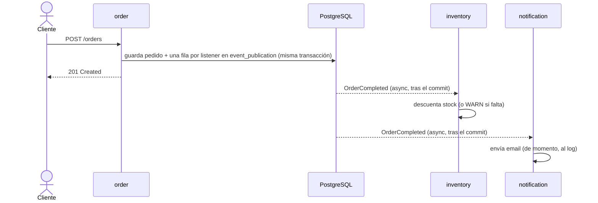

# Spring Modulith Shop

Proyecto de ejemplo de un **monolito modular** con [Spring Modulith](https://spring.io/projects/spring-modulith): una tienda mínima donde cada módulo tiene fronteras claras, se comunica por eventos y puede probarse por separado.

Acompaña a una serie de posts de LinkedIn y a 4 artículos del [blog de DatIACode](https://www.datiacode.com/blog). Cada artículo apunta a un tag de git con el estado exacto del código que explica.

> **Qué no es:** un e-commerce completo. No hay frontend, pagos ni catálogo con búsqueda; solo lo justo para que los conceptos de Modulith tengan un escenario creíble.

## Stack

| Pieza | Versión |
|---|---|
| Java | 21 |
| Spring Boot | 4.1.1 |
| Spring Modulith | 2.1.1 |
| Spring AI | 2.0.1 |
| PostgreSQL | 16 (Docker) |
| Flyway | gestionado por Spring Boot |
| springdoc-openapi | 3.1.1 |

## Requisitos

- JDK 21
- Docker + Docker Compose
- No hace falta Maven instalado: el proyecto incluye `./mvnw`.

## Arranque rápido

```bash
# 1. Variables locales (credenciales de desarrollo)
cp .env.example .env

# 2. Base de datos (PostgreSQL en el puerto 5442)
docker compose up -d postgres

# 3. Aplicación con el perfil dev
./mvnw spring-boot:run -Dspring-boot.run.profiles=dev

# 4. Comprobación
curl localhost:8080/actuator/health
# {"groups":["liveness","readiness"],"status":"UP"}
```

Flyway crea el esquema al arrancar. Hibernate solo lo valida (`ddl-auto=validate`).

## Tests

```bash
./mvnw test
```

Los tests de integración levantan PostgreSQL con Testcontainers, así que Docker tiene que estar en marcha. No necesitan el `docker compose` de desarrollo.

| Test | Qué cubre |
|---|---|
| `ModularityTest` | Fronteras entre módulos (`verify()`), named interfaces y que `order` no dependa de `inventory` |
| `DefaultCatalogServiceTest`, `DefaultInventoryServiceTest`, `DefaultOrderServiceTest` | Lógica de negocio (JUnit 5 + Mockito) |
| `OrderControllerTest` | Capa HTTP con `@WebMvcTest`: 201/400/404/422 |
| `OrderCompletedListenerTest` | Listener de stock, incluida la falta de stock |
| `InventoryModuleTests`, `NotificationModuleTests` | Un solo módulo arrancado con `@ApplicationModuleTest`, estimulado con `Scenario.publish(...)` |
| `EventRepublicationTests` | Republicación de eventos incompletos tras reiniciar |
| `ShopApplicationTests` | Arranque completo contra PostgreSQL (Testcontainers) |
| `DocumentationTest` | Genera `docs/modules/` (solo con `-Pdocs`) |

## Módulos y fronteras

Spring Modulith trata cada **paquete directo** bajo `com.datiacode.shop` como un módulo. Lo que está en la raíz del módulo es su API pública; lo que está en `internal` no lo puede usar ningún otro módulo.

```
com.datiacode.shop
 ├── ShopApplication.java
 ├── catalog
 │    ├── CatalogService.java            ← API pública
 │    ├── model                          ← @NamedInterface("model")
 │    │    └── ProductInfo.java
 │    └── internal                       ← oculto: Product, ProductRepository, DefaultCatalogService
 ├── inventory
 │    ├── InventoryService.java          ← API pública (consulta de stock)
 │    └── internal                       ← oculto: StockItem, StockItemRepository, DefaultInventoryService
 ├── notification
 │    └── internal                       ← oculto: OrderConfirmationListener, EmailSender
 ├── order
 │    ├── OrderService.java              ← API pública
 │    ├── NewOrder.java, OrderDetails.java
 │    ├── OrderCompleted.java            ← evento público
 │    ├── UnknownProductException.java, OrderNotFoundException.java
 │    └── internal                       ← oculto: Order, OrderRepository, OrderController, ...
 └── shared
      ├── config                         ← beans transversales (Clock, @EnableAsync)
      └── web                            ← GlobalExceptionHandler (errores del framework)
```

| Módulo | Expone | Depende de |
|---|---|---|
| `catalog` | `CatalogService`, `model::ProductInfo` | — |
| `inventory` | `InventoryService` | `order` (escucha `OrderCompleted`) |
| `order` | `OrderService`, `OrderCompleted`, records y excepciones de dominio | `catalog` (consulta síncrona de nombre y precio) |
| `notification` | — | `order` (escucha `OrderCompleted`) |
| `shared` | — | — |

**Llamar o avisar.** `order → catalog` es una llamada síncrona: sin nombre y precio no se puede guardar el pedido. Lo que pasa *después* (descontar stock, avisar al cliente) va por eventos: `order` publica `OrderCompleted` y no conoce a quien lo escucha.

**Por qué `catalog` e `inventory` son módulos distintos.** El primer diseño tenía un solo `inventory` con precio y stock, y `order` le consultaba el stock antes de aceptar el pedido. Pero si además `inventory` escucha `OrderCompleted`, depende de `order`, y el resultado es un ciclo `order ↔ inventory` que `verify()` rechaza. Separar lo que se vende (`catalog`) de lo que hay en el almacén (`inventory`) rompe el ciclo. A cambio, el stock ya no se comprueba antes de aceptar el pedido: es **consistencia eventual**, e `inventory` gestiona la falta de stock cuando procesa el evento. `ModularityTest.orderDoesNotDependOnInventory` vigila que siga así.

**Doble protección.** Las clases de `internal` son package-private, así que Java ya impide la mayoría de accesos ilegales. Cuando una clase interna tiene que ser pública (algo habitual en proyectos reales), quien vigila la frontera es `ApplicationModules.verify()`.

### Verificar la estructura

```bash
./mvnw test -Dtest=ModularityTest
```

La rama `demo/verify-roto` añade a propósito un acceso de `order` a `catalog.internal.ProductRepository`. En esa rama el test falla con:

```
- Module 'order' depends on non-exposed type com.datiacode.shop.catalog.internal.ProductRepository within module 'catalog'!
Field <com.datiacode.shop.order.internal.StockShortcut.products> has type <...ProductRepository> in (StockShortcut.java:0)
```

La salida completa está en [`docs/verify-error.txt`](docs/verify-error.txt).

### Documentación generada

```bash
./mvnw test -Pdocs
```

Genera en [`docs/modules/`](docs/modules/) el diagrama de componentes C4 (`components.puml`), un diagrama y un canvas por módulo, y `modules.txt` con las named interfaces. Los canvases de Modulith 2.1.1 no las muestran. El test lleva el tag `documentation` y queda fuera del build normal.

### API

| Método | Ruta | Respuestas |
|---|---|---|
| `POST` | `/orders` | 201 pedido creado · 400 petición inválida · 422 SKU que no existe en el catálogo |
| `GET` | `/orders/{id}` | 200 · 404 |

```bash
curl -X POST localhost:8080/orders -H 'Content-Type: application/json' \
  -d '{"customer":"alice","items":[{"sku":"KB-001","quantity":1},{"sku":"MS-001","quantity":2}]}'
```

Swagger UI: <http://localhost:8080/swagger-ui/index.html>. Productos de ejemplo: `KB-001`, `MS-001`, `MN-001` y `HD-001` (este último con stock 0, para ver cómo reacciona `inventory`).

## Eventos y fiabilidad

Cuando se acepta un pedido, `order` publica `OrderCompleted` y se desentiende. Quien esté interesado lo escucha:



```java
// order: publica dentro de la transacción del pedido
events.publishEvent(toEvent(order));

// inventory y notification: cada uno en su hilo y su transacción
@ApplicationModuleListener
void on(OrderCompleted event) { ... }
```

| Módulo | Dependencia | Tipo |
|---|---|---|
| `order` | `catalog` | `USES_COMPONENT` (llamada síncrona) |
| `inventory` | `order` | `EVENT_LISTENER` |
| `notification` | `order` | `EVENT_LISTENER` |

`@ApplicationModuleListener` combina `@TransactionalEventListener` (solo tras el commit), `@Async` (otro hilo, el executor `shop-async-*`) y `@Transactional(REQUIRES_NEW)` (transacción propia).

### Event Publication Registry

Cada publicación queda registrada en la tabla `event_publication` (migración `V2`), con una fila por listener y su estado (`PUBLISHED`, `PROCESSING`, `COMPLETED`, `FAILED`...). Con `spring.modulith.events.republish-outstanding-events-on-restart=true`, las filas que no llegaron a completarse se reenvían al arrancar.

- **Demo manual:** [`docs/demo-caida.md`](docs/demo-caida.md). Perfil `demo` + `kill -9` a mitad del listener de `notification`; al reiniciar solo se reprocesa ese listener.
- **Demo automática:** `EventRepublicationTests`. Dos contextos arrancados uno tras otro contra el mismo PostgreSQL.
- **Entrega al menos una vez:** un listener puede ejecutarse más de una vez, así que tiene que ser idempotente.

```sql
SELECT substring(listener_id from '([A-Za-z]+Listener)') AS listener, status, completion_date
FROM event_publication ORDER BY publication_date DESC LIMIT 4;
```

## Perfiles

| Perfil | Uso |
|---|---|
| `dev` | Desarrollo local contra los servicios de `docker-compose.yml`; lee `.env` |
| `test` | Tests; la base de datos llega por Testcontainers |
| `demo` | Combinado con `dev`: pausa de 20 s en el listener de `notification` para la demo de caída |
| `prod` | Variables de entorno `DATABASE_*`, sin Swagger, log a fichero con rotación |

## Tags y artículos

| Tag | Artículo | Contenido |
|---|---|---|
| `blog-1-modulos` | Fundamentos | Módulos `catalog`, `inventory` y `order`, API vs `internal`, `@NamedInterface`, `verify()`, `Documenter` |
| `blog-2-eventos` | Eventos y fiabilidad | `OrderCompleted`, listeners en `inventory` y `notification`, Event Publication Registry, republicación y demo de caída |
| `blog-3-externalizacion` | Salir del monolito | *(pendiente)* |
| `blog-4-ia-testing` | IA, testing y camino a microservicios | *(pendiente)* |

## Estado

En construcción. El plan de desarrollo está en [`PLAN.md`](PLAN.md) y el registro de cambios en [`CHANGELOG.md`](CHANGELOG.md).
